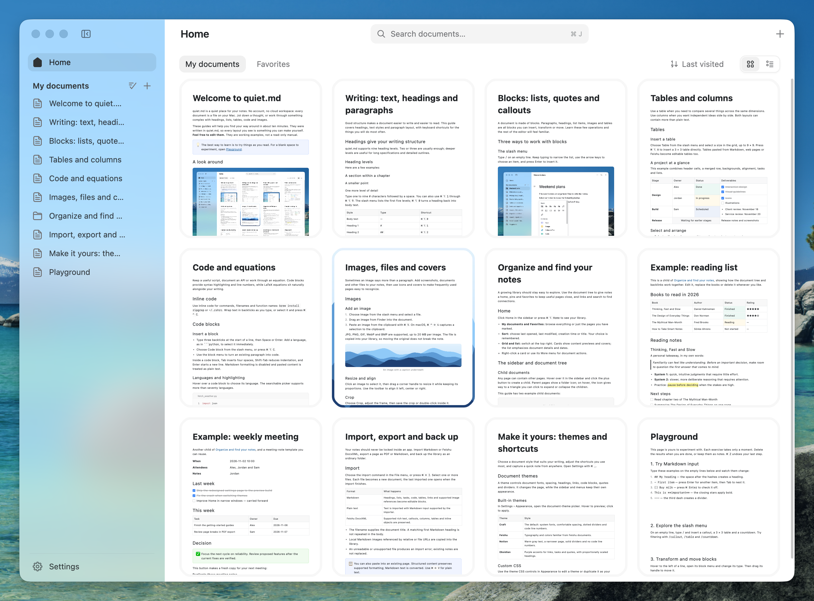

<h1 align="center">quiet-md</h1>

  <b>一个又快又安静的本地笔记应用。</b> 
  Rust + GPUI 原生绘制，笔记全部存在你的电脑上，兼容飞书文档的 DocxXML 格式。 
  基于 <a href="https://github.com/s1dashu/quiet-md">s1dashu/quiet-md</a>（MIT）修改，新增 Linux 适配、文本 / PDF 导出、四协议同步等功能。

  
  
  
  

  <a href="#下载"><b>下载</b></a> ·
  <a href="#本版新增"><b>本版新增</b></a> ·
  <a href="#功能">功能</a> ·
  <a href="#性能">性能</a> ·
  <a href="CONTRIBUTING.md">参与开发</a>

  

> [!NOTE]
> 本仓库是 [s1dashu/quiet-md](https://github.com/s1dashu/quiet-md) 的修改版，目前同样是 **Beta 版本**。遇到 bug 或有想法，欢迎[提 issue](https://github.com/itlaborer/quiet-md/issues)。原版 macOS 安装包请到[原项目 Releases](https://github.com/s1dashu/quiet-md/releases/latest) 下载。

## 本版新增

在原项目基础上增加：

- **🐧 Linux 适配**：X11 / Wayland 桌面可用，提供 Linux x86_64 预编译包。
- **📤 「下载为 → 文本 / PDF」导出**：整篇笔记可导出为纯文本；Linux 下通过本机 Chromium / Chrome 无头渲染导出 PDF（可用 `QUIET_MD_BROWSER` 指定浏览器路径）。
- **🔄 FTP / SFTP / SMB / S3 双向增量同步**：四种协议**独立配置、可同时启用**，各自记录同步状态；支持自动同步与手动立即同步，带冲突处理。
- **🔑 密码默认掩码**：同步配置中的密码 / 密钥默认以 `•` 显示，可点「显示 / 隐藏」切换。
- **📥 纯文本导入**：除 Markdown 和飞书 DocxXML 外，支持 `txt / log / csv / sql` 等 15 种纯文本扩展名，内容原样保留为代码块。
- **🚀 一键发布**：把当前笔记发布到 GitHub Pages 仓库（如 `itlaborer.github.io/books`）、微信公众号草稿箱，或头条号 / 百家号等开放平台。凭证只存本地，详见 [发布指南](docs/PUBLISH.md)。

## 下载

| 平台 | 下载 | 系统要求 |
|---|---|---|
| **Windows**（x64） | [quiet_md-0.1.3-windows-x86_64-r5.zip](https://github.com/itlaborer/quiet-md/raw/master/release/quiet_md-0.1.3-windows-x86_64-r5.zip)（约 26.6 MB） | Windows 10 2004 及以上 |
| **Linux**（x86_64） | [quiet_md-0.1.3-linux-x86_64-r5.tar.xz](https://github.com/itlaborer/quiet-md/raw/master/release/quiet_md-0.1.3-linux-x86_64-r5.tar.xz)（约 18.5 MB） | 带 X11 / Wayland 的桌面环境 |

- SHA-256 校验值见 [release/SHA256SUMS.txt](release/SHA256SUMS.txt)。
- 也可以从[下载站](https://quiet-md-downloads-2pu2wl7hg18.qoder.zone)获取。
- **Windows**：解压后运行 `quiet_md.exe`。如果首次运行出现 SmartScreen 提示，点「更多信息 → 仍要运行」即可。
- **Linux**：解压后运行 `./quiet_md`；PDF 导出需要本机装有 Chromium / Chrome。
- **macOS**：本仓库不提供 macOS 构建，请到[原项目](https://github.com/s1dashu/quiet-md/releases/latest)下载（不含上述新增功能）。

首次启动会在空文档库里放一套「开始指南」，十分钟带你过一遍主要功能；已有的笔记不会被覆盖。

## 功能

- **编辑**：标题、有序 / 无序列表、待办、引用、代码块（语法高亮）、LaTeX 公式、表格（可合并单元格）、高亮块、分栏、图片、附件、封面。支持 `#`、`-`、`[]`、`>` 等 Markdown 快捷输入和 `/` 斜杠菜单。
- **整理**：文档树、置顶、收藏、全文搜索、回收站。
- **导入导出**：导入 Markdown、飞书 DocxXML 和 txt / log / csv / sql 等纯文本；导出 Markdown、文本、PDF，也可以直接打印。从飞书或网页粘贴时保留结构。
- **同步**：FTP / SFTP / SMB / S3 双向增量同步，四协议独立配置、可同时启用，支持自动同步；密码默认掩码显示。
- **发布**：「…」菜单 → 发布到，把笔记发到 GitHub / 微信公众号 / 头条 / 百家；配置在「设置 → 发布」，见 [发布指南](docs/PUBLISH.md)。
- **快捷键**：按 `⌘ /` 查看全部快捷键，每一个都能改。
- **主题**：内置 Craft、飞书、Notion、Obsidian 四套风格，也可以用 CSS 自己写，见 [docs/THEMES.md](docs/THEMES.md)。

## 性能

在一篇 **100 万字**、549 章的混合文档里连续操作 100 次，统计每帧处理耗时：

| 操作 | P50 | P95 |
|---|---:|---:|
| ⌨️ 连续输入 | **5.06 ms** | 5.78 ms |
| ⌫ 连续退格 | **4.99 ms** | 5.55 ms |
| 🖱️ 连续滚动 | **2.08 ms** | 4.14 ms |

120 Hz 屏幕每帧的预算是 8.3 ms，百万字文档下的 P95 也留有余量。

数据来自原项目：Apple M5 Pro / 48 GiB，macOS 26.5，Release 构建。测试方法和复现脚本见 [docs/PERFORMANCE.md](docs/PERFORMANCE.md)。

## 你的文件在哪

默认在 `~/Documents/Quiet.md`（Windows 是「文档」下的 `Quiet.md`）。每篇笔记是 `docs/` 里的一份 XML，图片和附件在 `assets/`。

目录结构和格式细节见 [docs/FORMAT.md](docs/FORMAT.md)。

## 参与开发

从源码构建、测试和打包见 [CONTRIBUTING.md](CONTRIBUTING.md)，代码结构见 [docs/ARCHITECTURE.md](docs/ARCHITECTURE.md)。

## 许可

代码使用 [MIT](LICENSE) 许可（原项目 © s1dashu）。第三方代码、字体和素材见 [THIRD_PARTY.md](THIRD_PARTY.md)。

以下内容不在 MIT 范围内，fork 时请替换：

- `assets/icons/` 里的 67 个 Nucleo 图标使用 Nucleo 商业授权，请勿单独提取再分发；
- 「quiet.md」这个名字和应用图标。
